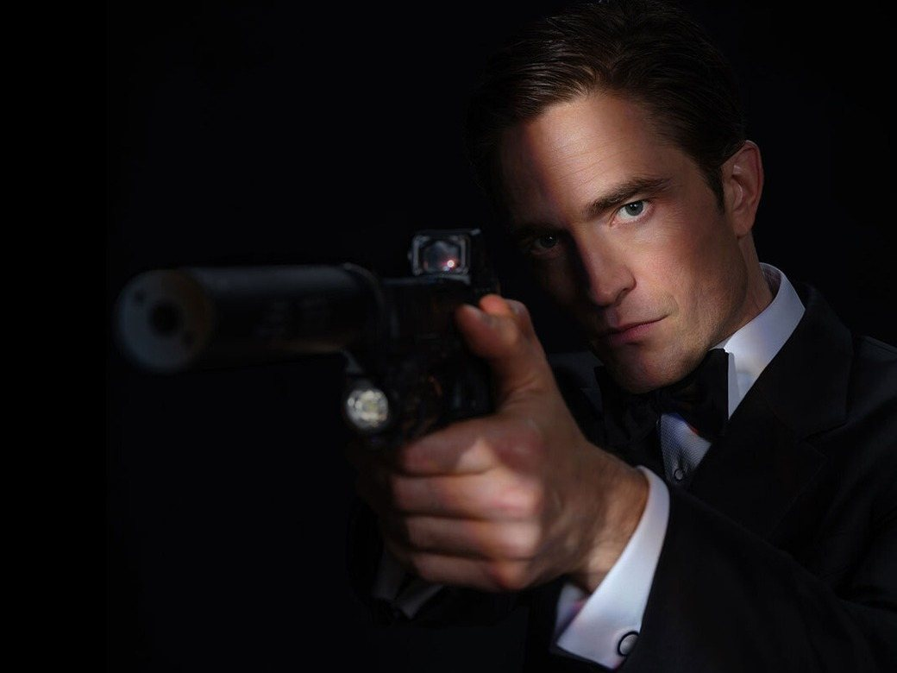
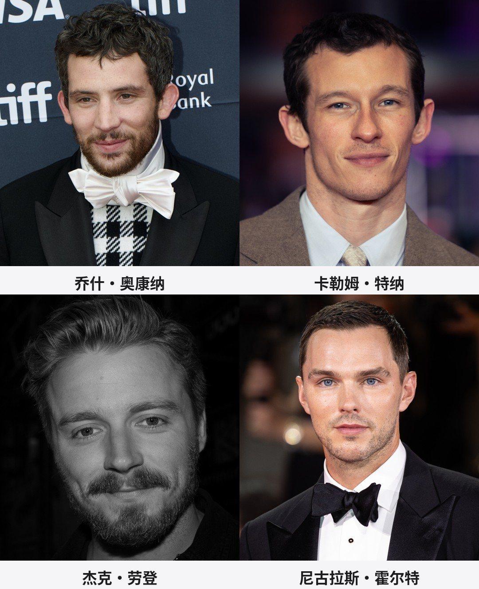
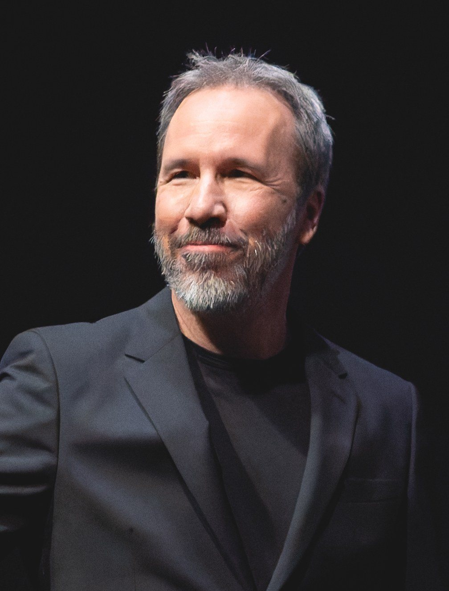

11月16日，亚马逊米高梅官宣：40岁的英国演员罗伯特·帕丁森成为第七任詹姆斯·邦德。官宣方式很邦德：007官方账号先清空全部内容，只留一句「身份已确认」，随后放出一段26秒的预告和他身穿燕尾服、持枪的首张照片。除了人选本身，这场持续了几年的选角，还落定了不少信息。

## 一、他是怎么被选出来的

终选一共5人，每人参加了3轮试镜：穿正式戏服，在真实布景里和其他演员搭戏，亚马逊创始人贝索斯本人参与了最终决定，而这个决定直到官宣前3天才做出。整套试镜的花费据《综艺》报道在30万到50万美元之间。

帕丁森是最后一刻入局的：11月初才参加试镜，此前任何一份候选名单上都没有他。贝索斯说得很坦白：起初对他有偏见，觉得他太有名，本想找一个没那么出名的；试镜之后改了主意——「他就是詹姆斯·邦德。」

合约也和别人不一样。据 Puck News 披露，帕丁森只签了三部，其他候选人被要求签四部，他的片酬也更高。他还是第一个同时演过蝙蝠侠和邦德的演员：《新蝙蝠侠2》正在伦敦拍摄、预计年底杀青，他就是趁那边的空档来试的镜，两个角色的档期正好错开。

## 二、陪跑的都有谁

制作方没有正式公布落选名单，但《Deadline》《好莱坞报道者》等媒体的口径基本一致，终选的另外4人是：乔什·奥康纳、卡勒姆·特纳、杰克·劳登、尼古拉斯·霍尔特。

其中奥康纳一度最受导演青睐，后来退出了竞争。还有一位连终选都没进：《夜魔侠》的主演查理·考克斯自曝曾主动要求试镜，被以「年纪太大」拒绝——他43岁。而最终胜出的帕丁森40岁，是终选5人里年纪最大的一个。

## 三、班底已经定死的

导演是丹尼斯·维伦纽瓦，编剧是《浴血黑帮》主创史蒂文·奈特，剧本初稿今年9月已经完成。制片人是艾米·帕斯卡（《蜘蛛侠》系列）和大卫·海曼（《哈利·波特》系列），执行制片是坦尼娅·拉波因特。

背景是2025年亚马逊米高梅从布罗科利家族手中取得007系列的创作控制权。所以这不只是一次换人，而是这个系列换了东家之后的第一部。

另外两个已经定死的条件：维伦纽瓦只导这一部邦德，不再续约；他也没有最终剪辑权，终剪在片方手里。

## 四、剧情往哪走

具体情节官方一个字没公布，能确认的只有两位主创亲口讲过的方向。奈特说，他直接从弗莱明原著小说里取材，看重原著的文风和对白；他把邦德比作罗宾汉那样的民间传说人物，初稿动笔时他已经知道主演是谁，但他写的是人物，不是演员。

维伦纽瓦在官宣后的采访里说，邦德首先是刺客，其次才是间谍，他要的是可信的杀气、眼底深处的愤怒，再加上魅力、性感和黑色幽默。有中文媒体传这部要讲邦德加入军情六处之前的海军经历，没有官方口径证实，只能当传闻看。
