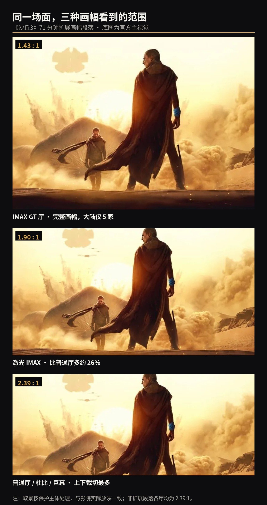
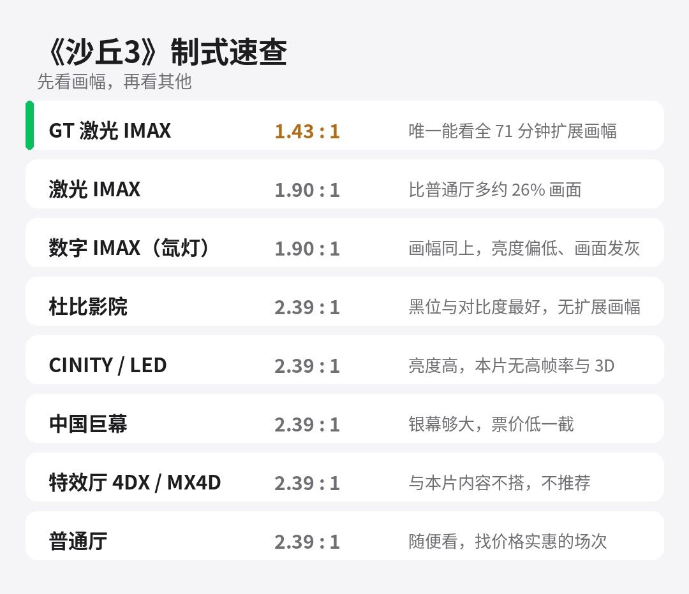
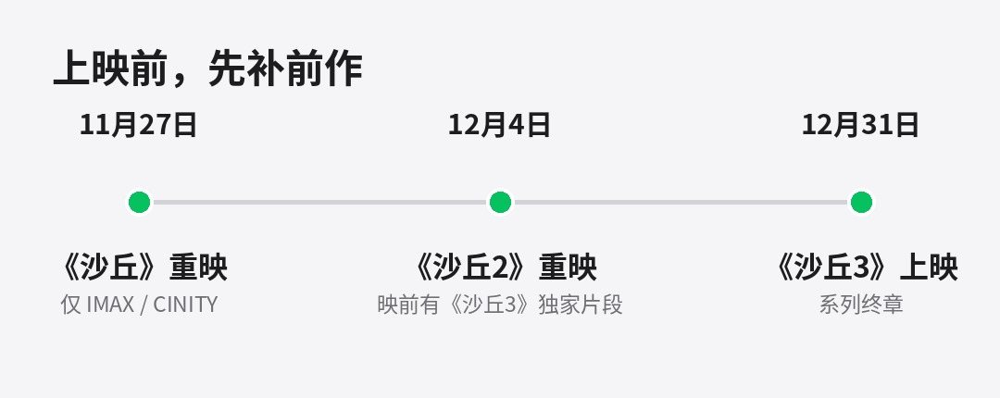

## 影片参数

《沙丘3》全片约140分钟，其中71分钟为 IMAX 专属扩展画幅。本片为系列首次胶片实拍，大部分使用65毫米胶片，IMAX 段落使用15/70胶片摄影机，沙漠段落使用 IMAX 数字摄影机，内地无胶片版本发行。根据发行信息，本片共有三种画幅版本：1.43 IMAX 版、1.9 IMAX 版、2.39 普通版。

## 内地发行版本

内地发行的版本为：（部分画面）1.43画幅 GT 激光 IMAX；（部分画面）1.9画幅激光 IMAX / 数字 IMAX；2.39画幅杜比影院 / CINITY / 中国巨幕 / 特效厅及普通厅。

## 制式推荐

绝对优势的版本为1.43画幅 GT 激光 IMAX，其次为1.9画幅激光 IMAX。本片使用 IMAX 摄影机实拍，IMAX 版为最忠于作者表达的版本

## 1.43 GT 激光 IMAX 影院（内地共五家）

东莞万达影城（华南MALL店），银幕约32×19.5米

北京中国电影博物馆，银幕约30×19.5米

哈尔滨万达影城（哈东万达广场店），银幕约28.7×21.3米

昆明大都激光IMAX影院，银幕约23.1×17.4米

沈阳辽宁省科技馆万达影城，排片较少

另注：贵阳越界影城挂的是 GT 招牌，但有资料显示它的银幕是1.90比例，不在此列

## 1.9 版本

当然不是所有人都能有精力和时间去 GT 城市，拥有1.9画幅的激光 IMAX 版本也是较好的选择，比普通宽银幕多约26%的画面。选厅认准「IMAX 激光」字样，优先银幕大的那家；只写 IMAX、不写激光的多为早年的数字（氙灯）厅，亮度偏低、画面发灰，排在激光之后。

